# Лабораторная работа №6 "Система контроля версий"

## Цель работы
Изучение базовых возможностей системы управления версиями, опыт работы с Git Api, опыт работы с локальным и удаленным репозиторием.

## Задание на лабораторную работу
1. Создать аккаунт на сайте GitHub.
2. Сделать копию в личное хранилище из https://github.com/Kurtyanik/LR6/ (Fork).
3. Установить Git (https://git-scm.com/).
4. Настроить клиент git, введя имя пользователя и email.
5. Клонировать свой личный удалённый репозиторий на компьютер.
6. Добавить файл через интерфейс GitHub. Подтянуть изменения в локальный репозиторий.
7. Получить историю операций для каждой из веток.
8. Просмотреть последние изменения.
9. Выполнить слияние в ветку master, разрешив конфликт.
10. Удалить побочную ветку после успешного слияния.
11. Сделать изменения и зафиксировать их, оставляя комментарии.
12. Сделать откат коммита.
13. Создать ветку для отчёта.
14. Начать оформлять отчёт в файле README.md, используя markdown синтаксис.
15. Добавить в отчёт историю операций в форматированном виде и сделать финальную фиксацию изменений.
16. Отправить локальные изменения в сетевое хранилище GitHub.

## Выполнение работы
### 1. Создание аккаунта на GitHub
К моменту выполнения работы аккаунт на сайте GitHub уже создан. Для выполнения лаборатоной работы выполнен вход в аккаунт.

### 2. Создание копии в личное хранилище
Для создания копии репозитория, выполнен переход по ссылке на репозиторий преподавателя, указаны параметры копирования (рис. 1) и создана копия (рис. 2).
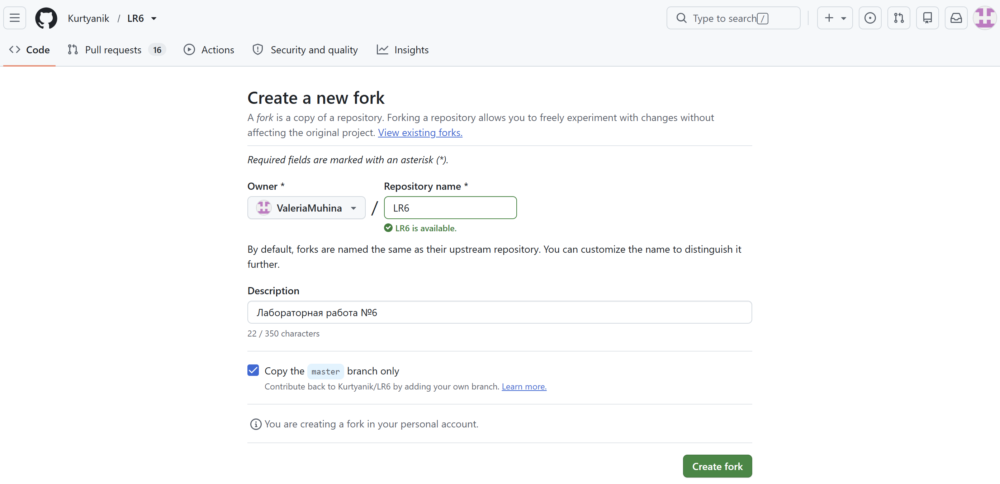
*Рисунок 1 - Параметры копирования*
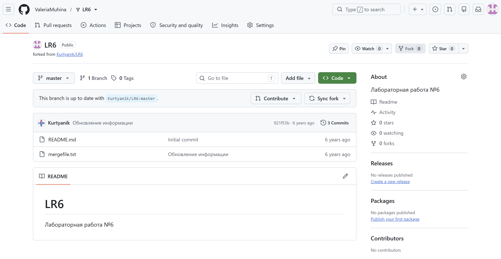
*Рисунок 2 - Копия репозитория*

### 3. Установка Git
Чтобы установить Git на устройство, необходимо перейти на сайт https://git-scm.com/, выбрать нужную версию и установить её.

### 4. Настройка клиента git
Для указания имени пользователя и его email необходимо ввести соответствующие команды:
```bash
git config --global user.name "(username)"
git config --global user.email "(email)"
```
Настройка клиента Git представлена на рисунке 3.
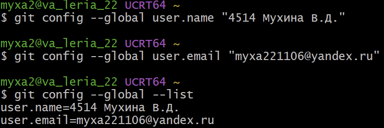
*Рисунок 3 - Настройка клиента Git*

### 5. Клонирование личного удалённого репозитория на компьютер
Чтобы клонировать личный удалённый репозиторий на компьютер необходимо скопировать ссылку на свой fork. Затем открывается Git Bash и указывается папка, в которой размещается проект:
```bash
cd (путь)
```
Далее клонируется репозиторий с помощью команды:
```bash
git clone (ссылка на репозиторий)
```
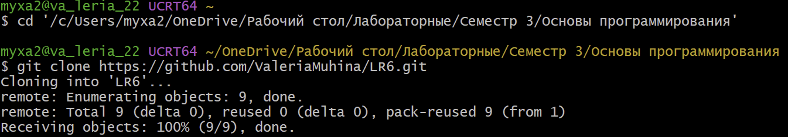
*Рисунок 4 - Клонирование репозитория*

### 6. Добавление файла. Подтягивание изменений в локальный репозиторий
Чтобы добавить файл через интерфейс GitHub, необходимо нажать кнопку Add File -> Create new file, задать имя файла и его содержимое, сохранить созданный файл (рис. 5).
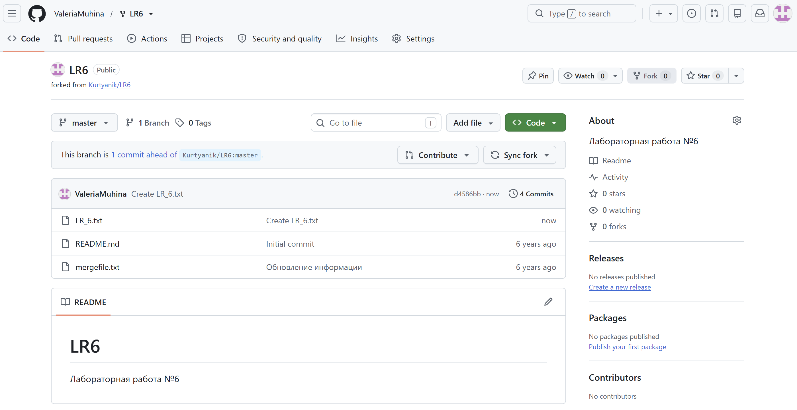
*Рисунок 5 - Добавлен файл LR_6.txt*

Подтягивание изменений в локальный репозиторий происходит с помощью команды:
```bash
git pull
```
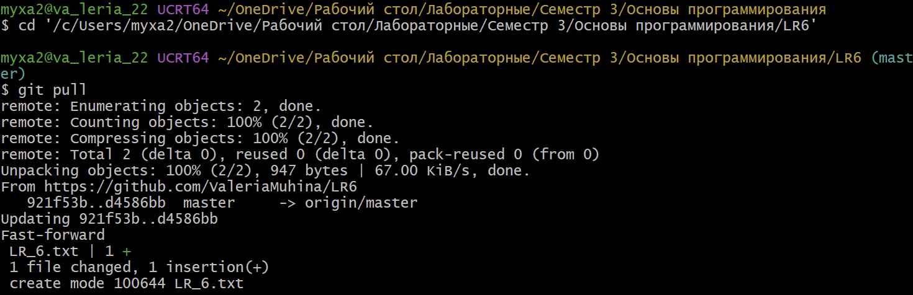
*Рисунок 6 - Подтягивание изменений*

### 7. История операций для каждой из веток
Перед тем как посмотреть историю операций для каждой ветки, необходимо узнать какие ветки есть:
```bash
git branch -a
```
История каждой ветки выводится с помощью команды:
```bash
git log --oneline (название ветки)
```
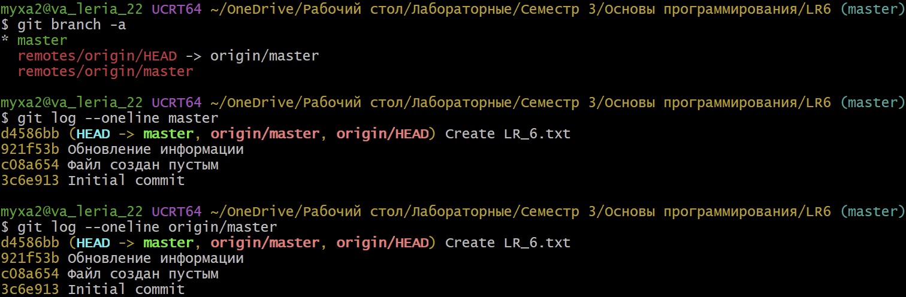
*Рисунок 7 - Истирия операций для веток*

### 8. Просмотр последних изменений
Посмотреть последнии внесённые изменения можно с помощью команды:
```bash
git show
```
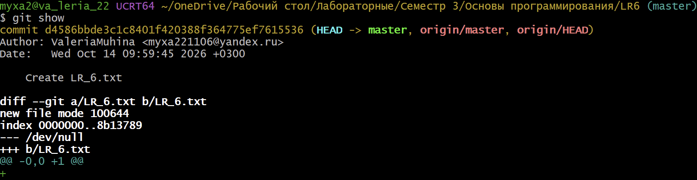
*Рисунок 8 - Истирия изменений*

### 9. Выполнение слияния в ветку master с разрешением конфликта
Чтобы выполнить слияние и разрешить конфликт, необходимо создать побочную ветку, перейти в неё и изменить файл. Создание побочной ветки и переход в неё осуществляется с помощью команды:
```bash
git checkout -b 'название ветки'
```
Далее необходимо открыть файл LR_6.txt в редакторе, изменить содержимое файла и зафиксировать изменения:
```bash
git add LR_6.txt
git commit -m "Изменение в ветке side_branch"
```
Затем надо вернуться в основную ветку:
```bash
git checkout master
```
 Далее добавить в тот же файл LR_6.txt другое содержание, зафиксировать изменения и добавить комментарий:
```bash
git add LR_6.txt
git commit -m "Изменение в ветке master"
```
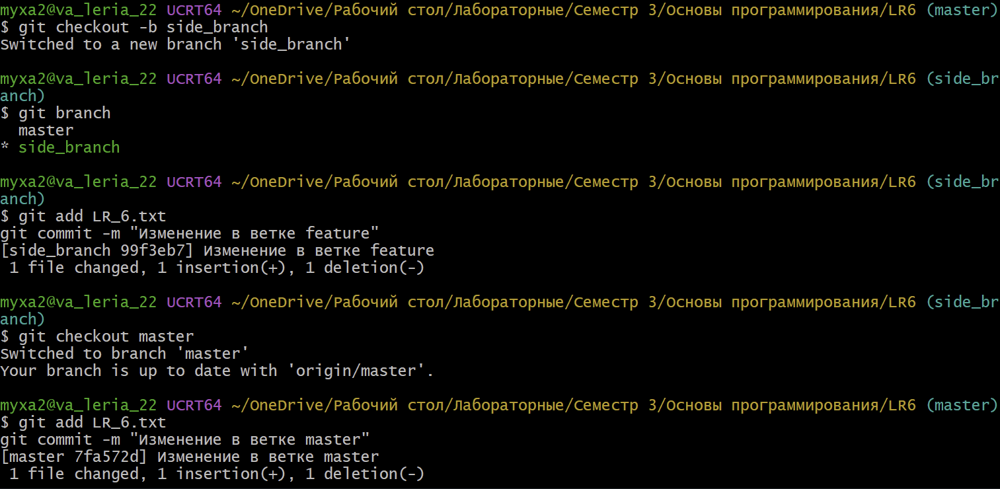 
*Рисунок 9 - Создание побочной ветки и фиксация изменений*

Выполнение слияния в основную ветку:
```bash
git merge side_branch
```
В результате слияния получен конфликт (рис. 10).
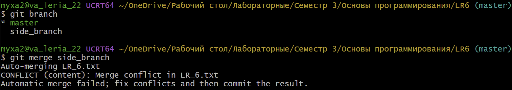 
*Рисунок 10 -Конфликт при слиянии*

Если открыть файл LR_6.txt в редакторе, можно увидеть маркеры конфликта (рис. 11), чтобы разрешить конфликт необходимо отредактировать файл, удалив маркеры конфликта и оставив тот вариант содержимого, который является нужным (рис. 12).
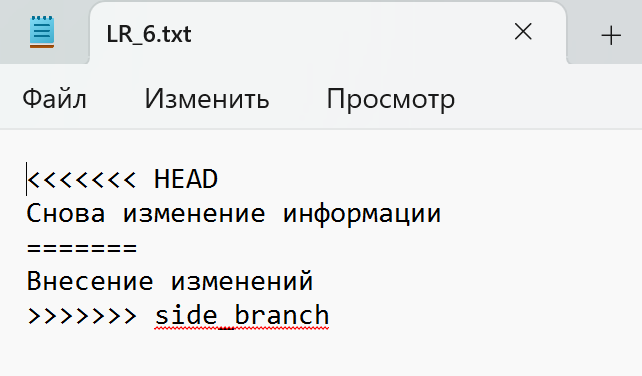
*Рисунок 11 - Маркеры конфликта*
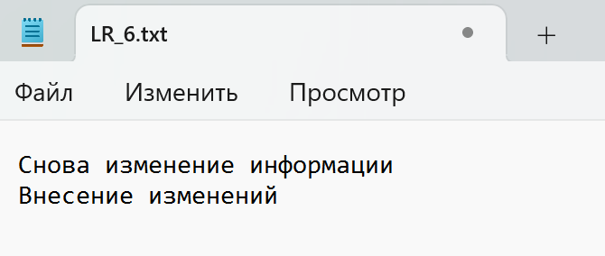 
*Рисунок 12 - Разрешение конфликта*

Сохранение изменений и завершение слияния веток:
```bash
git add LR_6.txt
git commit -m "Слияние side_branch в master, конфликт разрешён"
```
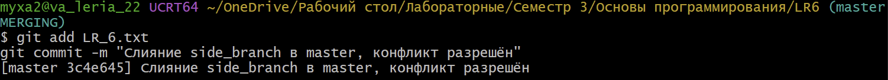
*Рисунок 13 - Слияние после разрешения конфликта*

### 10. Удаление побочной ветки
После слияния веток, удаляется побочная ветка (рис. 14):
```bash
git branch -d side_branch
```
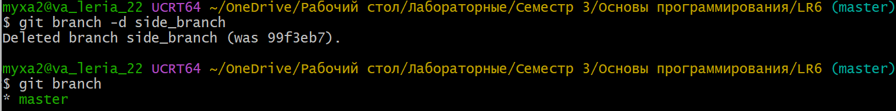
*Рисунок 14 - Удаление ветки*
### 11. Внесение изменений, их фиксирование и комментирование
В репозиторий внесены 4 изменения, два изменения произведени в файле LR_6.txt, также создан новый файл file.txt и там произведено одно изменение содержимого (рис. 14).
```bash
echo "Первое изменение после слияния" >> LR_6.txt
git add LR_6.txt
git commit -m "Добавлена первая строка после слияния"

echo "Второе изменение после слияния" >> LR_6.txt
git add LR_6.txt
git commit -m "Добавлена вторая строка после слияния"

echo "Это второй файл для проверки истории" > file.txt
git add file.txt
git commit -m "Создан файл file.txt"

echo "Изменение file.txt" >> file.txt
git add file.txt
git commit -m "Добавлена строка в file.txt"
```
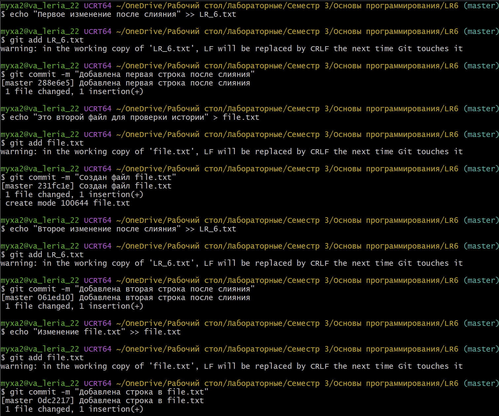
*Рисунок 15 - Внесение изменений*
### 12. Откат коммита
Для отката коммита использована команда, которая создаёт новый коммит, откатывающий изменения указанного:
```bash
git revert 0dc2217
``` 
После выполнения команды открывается редактор Vim (рис. 16), сообщение оставлено без изменений.
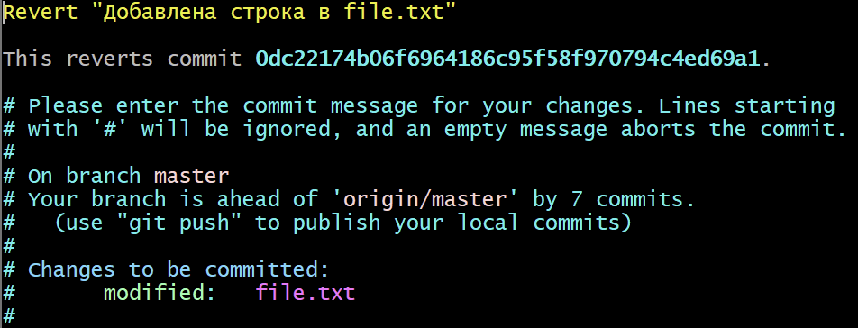
*Рисунок 16 - Сообщение коммита в редакторе Vim*
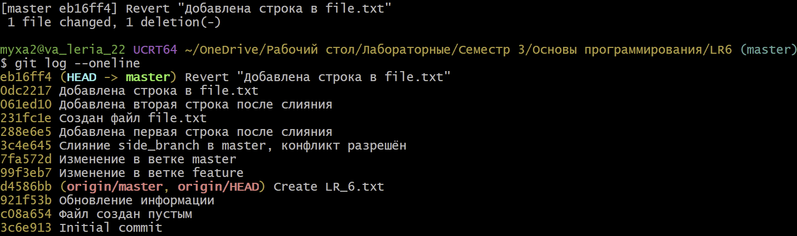
*Рисунок 17 - Откат коммита*

### 13. Создание ветки для отчёта
Для оформления отчёта создана новая ветка:
```bash
git checkout -b otchet
``` 
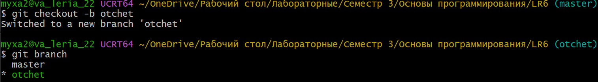
*Рисунок 18 - Ветка для отчёта*
### 14. Оформление отчёта
Отчет оформляется в файле README.md ветки otchet с использованием редактора VS Code (рис. 19).
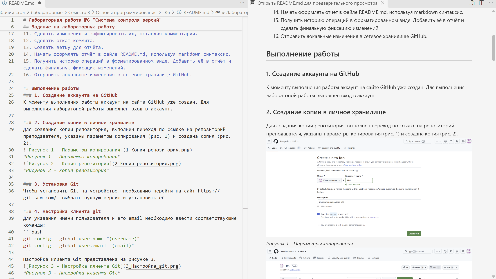
*Рисунок 19 - Оформление отчёта*

### 15. Получение истории операций в форматированном виде
История операций в форматированном виде (сокращённый хэш + дата + имя автора + комментарий) получена с помощью команды:
```bash
git log --pretty=format:"%h %ad %an %s" --date=short
``` 
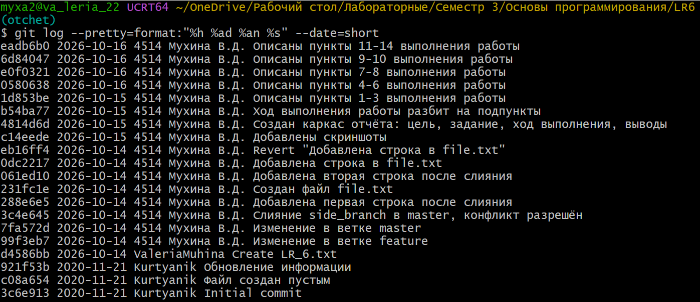
*Рисунок 20 - История операций*
### 16. Отправка локальных изменений в сетевое хранилище GitHub
eadb6b0 2026-10-16 4514 Мухина В.Д. Описаны пункты 11-14 выполнения работы
6d84047 2026-10-16 4514 Мухина В.Д. Описаны пункты 9-10 выполнения работы
e0f0321 2026-10-16 4514 Мухина В.Д. Описаны пункты 7-8 выполнения работы
0580638 2026-10-16 4514 Мухина В.Д. Описаны пункты 4-6 выполнения работы
1d853be 2026-10-15 4514 Мухина В.Д. Описаны пункты 1-3 выполнения работы
b54ba77 2026-10-15 4514 Мухина В.Д. Ход выполнения работы разбит на подпункты
4814d6d 2026-10-15 4514 Мухина В.Д. Создан каркас отчёта: цель, задание, ход выполнения, выводы
c14eede 2026-10-15 4514 Мухина В.Д. Добавлены скриншоты
eb16ff4 2026-10-14 4514 Мухина В.Д. Revert "Добавлена строка в file.txt"
0dc2217 2026-10-14 4514 Мухина В.Д. Добавлена строка в file.txt
061ed10 2026-10-14 4514 Мухина В.Д. Добавлена вторая строка после слияния
231fc1e 2026-10-14 4514 Мухина В.Д. Создан файл file.txt
288e6e5 2026-10-14 4514 Мухина В.Д. Добавлена первая строка после слияния
3c4e645 2026-10-14 4514 Мухина В.Д. Слияние side_branch в master, конфликт разрешён
7fa572d 2026-10-14 4514 Мухина В.Д. Изменение в ветке master
99f3eb7 2026-10-14 4514 Мухина В.Д. Изменение в ветке feature
d4586bb 2026-10-14 ValeriaMuhina Create LR_6.txt
921f53b 2020-11-21 Kurtyanik Обновление информации
c08a654 2020-11-21 Kurtyanik Файл создан пустым
3c6e913 2020-11-21 Kurtyanik Initial commit
## Выводы
